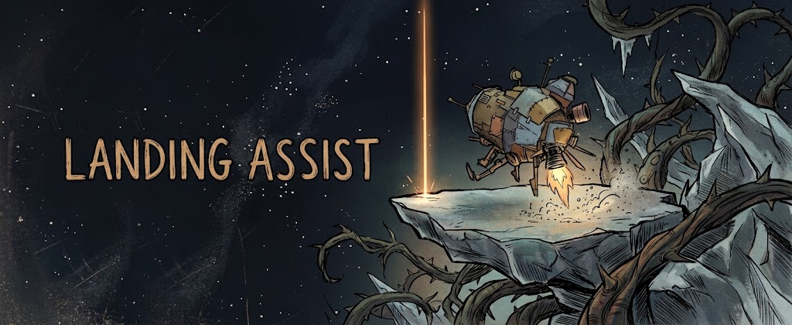

# Landing Assist

Point at the ground and the ship lands there.

## Features

- **Land where you look.** Aim at the ground from the cockpit (or through the landing camera) and press the land key. The ship flies over and sets itself down.
- **Finds a safe spot.** If the exact spot is too steep, uneven, under trees or in water, sand or a hazard, it picks the nearest good spot instead, or tells you why it can't.
- **Steers clear of obstacles.** Glides down toward the spot, holds height over trees and rocks, and comes straight down onto the landing spot.
- **Hop around.** Already landed? Aim somewhere else and it lifts off and lands again.
- **Firm, steady touchdown.** Settles the ship on its legs without bouncing. Choose how fast it comes down: Gentle, Normal or Fast.
- **Landing marker.** A thin orange beam shows where the ship is landing, and the cockpit prompt shows distance, height and descent speed.

## Controls

In the ship's cockpit:

| Action | Keyboard | Controller |
|---|---|---|
| Land at the cursor / cancel landing | B | D-pad Left |

Moving the flight controls also cancels a landing and gives control back to you. The controls can be changed in the mod settings.

## Settings

Landing speed, search radius, steepest ground allowed, travel height, aiming range, the landing marker and the controls are all adjustable in the mod manager's settings for this mod.

## Installation

Install with the [Outer Wilds Mod Manager](https://outerwildsmods.com/mod-manager/).

Works on Outer Wilds 1.1.16 with OWML 2.16. Works alongside [Better Autopilot](https://github.com/nocharts/ow-better-autopilot).

## Building

Requires the .NET SDK. `dotnet build LandingAssist/LandingAssist.csproj -c Release` builds the mod; if the Outer Wilds Mod Manager is installed (Flatpak), the build also copies it into the manager's mods folder.

## Made with AI assistance

The code for this mod was written with the help of an AI assistant and tested in-game by me. The cover art is AI-generated.

## Fan content notice

This work is unofficial Fan Content created under permission from the Mobius Digital Fan Content Policy. It includes materials which are the property of Mobius Digital and it is neither approved nor endorsed by Mobius Digital.

## License

[MIT](LICENSE)
